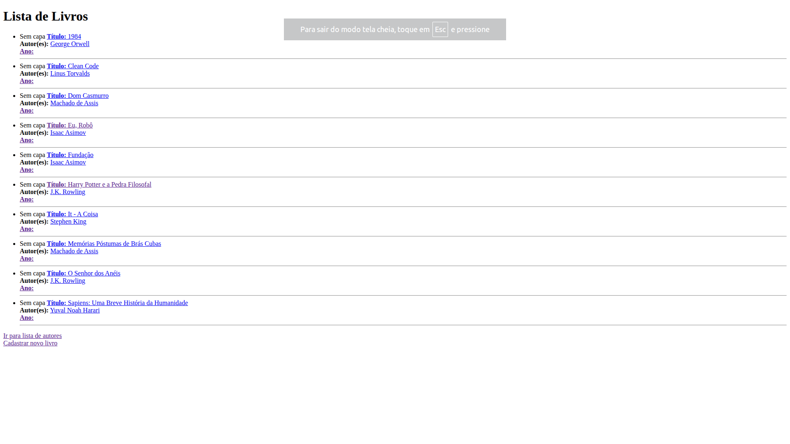

Nós escolhemos o on_delete.SET_NULL porque partiimos do pressuposto de que um livro pode ter mais de um autor, então se o autor x for excluído o y deveria permanecer. 

sem o csrf token ele não permite salvar no django, pq basicamente ele não confia no seu navegador já que você não tem um token que é necessário.

1.2 - a) O LivroModelForm não precisou de alterações lógicas manuais porque, ao herdar de forms.ModelForm, ele inspeciona automaticamente a classe Meta e o model associado. O Django replica as restrições definidas no banco de dados (como max_length, blank e null) e executa a lista de validators atrelada a cada campo. Como o Admin do Django gera formulários baseados nesses mesmos modelos, as regras de validação são aplicadas consistentemente em toda a aplicação sem necessidade de duplicação de código.

b) Um validator é uma função isolada e reutilizável que recebe apenas o valor do campo e levanta um erro se a regra for violada; ele é ideal para verificações simples e independentes. Já o método clean_<campo>() pertence à classe do formulário, tem acesso à instância completa (self) e permite tanto validar quanto transformar o dado (ex: aplicar .strip()). Um exemplo de regra exclusiva para clean_<campo>() seria garantir que o título seja salvo sempre em maiúsculas ou remover espaços em branco, pois isso exige a modificação do valor antes do salvamento, algo que um validator padrão não faz.

c) Para a regra em que o título não pode ser igual ao nome do autor, a estratégia correta é usar o método clean() geral do formulário, pois essa validação exige a comparação cruzada entre dois campos diferentes (titulo e autor_many), algo que só pode ser feito quando todos os dados já foram limpos individualmente. Já para garantir que o título seja salvo sem espaços no início e no fim, deve-se usar clean_titulo(), pois o objetivo não é apenas validar, mas transformar o dado antes do salvamento, retornando o valor já formatado com .strip(). Para limitar o número de páginas a no máximo 5000, a melhor estratégia é usar validators=[MaxValueValidator(5000)], pois é uma restrição numérica simples e nativa que se beneficia dos validadores embutidos do Django, mantendo o código mais limpo e declarativo. Por fim, para a regra de que um livro indisponível precisa ter o ISBN preenchido, deve-se usar novamente o método clean(), pois trata-se de uma validação condicional que depende do valor de outro campo (disponivel), exigindo acesso a múltiplos dados do formulário simultaneamente para verificar a consistência entre eles.

2.2 - a) Se esquecermos request.FILES na view, o formulário será instanciado apenas com os dados de texto (request.POST). O Django ignorará completamente o arquivo enviado, e o campo capa ficará vazio ou manterá o valor anterior, sem gerar nenhum erro explícito de validação. Se esquecermos o enctype="multipart/form-data" no template, o navegador enviará apenas o nome do arquivo como uma string simples, e não o conteúdo binário da imagem. Nesse caso, o request.FILES virá vazio e o formulário provavelmente acusará que o campo é obrigatório (se não for blank=True) ou simplesmente não salvará a imagem.

b) STATICFILES_DIRS e a tag  são usados para arquivos que fazem parte do projeto e não mudam, como CSS, JavaScript e imagens de layout (logo do site). Já MEDIA_ROOT e a propriedade .url são destinados a arquivos enviados dinamicamente pelos usuários, como a capa do livro. Na Mini Biblioteca, usamos  para o estilo visual do site e {{ livro.capa.url }} para exibir as capas que os usuários fizeram upload.

c) Isso acontece porque o Django, por padrão, não gerencia a exclusão física de arquivos do disco quando um objeto do modelo é deletado ou quando um campo de arquivo é atualizado; ele apenas remove a referência no banco de dados. A longo prazo, isso causa o acúmulo de "arquivos órfãos", desperdiçando espaço em disco e dificultando a organização e o backup do servidor.

d) A extensão do arquivo pode ser facilmente falsificada (ex: renomear um script malicioso .exe para .jpg). Outros cuidados essenciais incluem: validar o "magic number" (assinatura real do arquivo) para garantir que é uma imagem válida, limitar o tamanho do arquivo para evitar ataques de negação de serviço (DoS) que lotam o disco, armazenar os uploads fora da raiz pública do servidor web e usar nomes de arquivo aleatórios para evitar sobrescrita e execução de scripts.

3.1 - a) A própria CreateView (e todas as ModelFormMixin) gerencia automaticamente a verificação do método HTTP. Internamente, ela chama get() para requisições GET e post() para requisições POST. Quando o formulário é inválido, a view re-renderiza o template passando o formulário com os erros de validação expostos, permitindo que o usuário corrija os dados sem perder o que já foi preenchido.

b) A CreateView herda de ModelFormMixin, que automaticamente instancia o formulário passando request.POST e request.FILES quando o método é POST. O Django sabe que se o formulário tem campos de arquivo, ele deve buscar os dados em request.FILES, então não precisamos fazer isso manualmente como fazíamos nas views de função.

c) A DeleteView exibe um template de confirmação no GET e só executa a exclusão quando recebe um POST. Isso é uma proteção de segurança contra ataques CSRF e exclusões acidentais. Se a exclusão ocorresse em um GET, qualquer link ou imagem maliciosa em outro site poderia apontar para a URL de exclusão e deletar registros sem a confirmação do usuário, além de bots de indexação poderem acionar a exclusão acidentalmente ao rastrear links.

d) Vantagem: As CBVs reduzem drasticamente a quantidade de código boilerplate. Operações CRUD comuns (listar, detalhar, criar, editar, excluir) são implementadas com poucas linhas, pois o Django já fornece mixins e classes base que gerenciam formulários, templates e redirecionamentos automaticamente. Desvantagem: CBVs podem ser menos flexíveis para lógicas muito específicas ou não convencionais. Quando você precisa de um fluxo de controle muito personalizado (ex: múltiplos formulários na mesma view, validações complexas que dependem de contexto externo, ou integrações com APIs), o código pode ficar mais confuso e difícil de debugar do que uma função simples. Eu escolheria uma FBV quando a lógica for muito específica e não se encaixar nos padrões CRUD, quando precisar de múltiplas operações em uma única requisição, ou quando a equipe tiver menos familiaridade com a hierarquia de classes do Django e preferir código mais linear e explícito.

QUESTÃO DE PESQUISA 

1. Diferenças entre SQLite e PostgreSQL
O SQLite é um banco de dados embutido que armazena todos os dados em um único arquivo local, não requerendo instalação de servidor ou configuração complexa de usuários e senhas. Ele é extremamente leve e ideal para desenvolvimento local, testes automatizados, aplicações desktop e prototipagem rápida. No entanto, possui limitações significativas em cenários de alta concorrência, onde múltiplos usuários tentam escrever dados simultaneamente, e não suporta tipos de dados avançados ou extensões complexas. O PostgreSQL, por outro lado, é um sistema gerenciador de banco de dados relacional cliente-servidor robusto e open-source. Ele suporta alta concorrência através do mecanismo MVCC (Multi-Version Concurrency Control), transações ACID rigorosas, tipos de dados especializados como JSONB, arrays e geometria, além de extensões que ampliam suas capacidades. É utilizado em aplicações reais de produção, sistemas com múltiplos usuários simultâneos e cenários que exigem integridade de dados forte e alta disponibilidade. A escolha entre eles depende do contexto: SQLite é perfeito para desenvolvimento e testes, enquanto PostgreSQL é essencial para produção e aplicações que precisam escalar.
2. Driver do Django para PostgreSQL
O Django necessita do driver psycopg para se comunicar com o PostgreSQL. Atualmente, existem duas versões principais: o psycopg2 (versão 2, mais consolidada) e o psycopg (versão 3, mais recente). Para instalar, utiliza-se o comando pip install psycopg2-binary para ambientes de desenvolvimento, que é mais simples pois já vem compilado. Para produção, recomenda-se pip install psycopg2 sem o sufixo binary, pois este é compilado especificamente para o sistema operacional em uso, oferecendo melhor performance e compatibilidade.
3. Significado das chaves do DATABASES
No dicionário DATABASES do settings.py, cada chave possui um papel específico na configuração da conexão. A chave ENGINE define qual backend de banco de dados o Django utilizará, sendo para PostgreSQL o valor django.db.backends.postgresql. A chave NAME especifica o nome do banco de dados criado no PostgreSQL, como biblioteca_db. A chave USER indica o usuário do PostgreSQL que terá permissão para acessar o banco, enquanto PASSWORD contém a senha desse usuário. A chave HOST define o endereço do servidor onde o PostgreSQL está rodando, sendo localhost ou 127.0.0.1 para desenvolvimento local, ou um IP/domínio em produção. Por fim, a chave PORT especifica a porta de conexão, sendo 5432 o padrão do PostgreSQL.
4. Criação de banco e usuário próprio
Nunca se deve utilizar o superusuário postgres em aplicações reais, pois isso representa um risco de segurança significativo. Para criar um banco e usuário dedicados, acessa-se o terminal do PostgreSQL através do comando psql e executam-se comandos SQL específicos. Primeiro, cria-se o usuário com CREATE USER biblioteca_user WITH PASSWORD 'senha_segura', definindo uma senha forte. Em seguida, cria-se o banco com CREATE DATABASE biblioteca_db OWNER biblioteca_user, tornando o novo usuário dono do banco. Concede-se permissões totais com GRANT ALL PRIVILEGES ON DATABASE biblioteca_db TO biblioteca_user. Em versões mais recentes do PostgreSQL (15+), é necessário também conceder acesso ao schema public através de GRANT ALL ON SCHEMA public TO biblioteca_user após conectar ao banco.
5. Variáveis de ambiente e segurança
Variáveis de ambiente são valores configurados fora do código da aplicação, sendo injetados pelo sistema operacional ou lidos de arquivos específicos como o .env. Elas permitem que a mesma base de código funcione em diferentes ambientes (desenvolvimento, staging, produção) apenas alterando as variáveis, sem necessidade de modificar o código-fonte. Não se deve escrever senhas diretamente no código por múltiplas razões de segurança e praticidade. Se o código for versionado em repositórios como GitHub e tornado público acidentalmente, todas as credenciais ficarão expostas e comprometidas. Além disso, diferentes ambientes exigem credenciais diferentes, e a rotação de senhas não deve exigir alterações no código e novo deploy. Boas práticas de segurança, como as recomendadas pela OWASP, exigem que segredos fiquem completamente fora do código-fonte.
6. Uso de python-decouple para leitura do .env
A biblioteca python-decouple é utilizada para ler variáveis de ambiente de forma estrita, separando completamente a configuração do código. Após instalá-la com pip install python-decouple, importa-se a função config no settings.py e utiliza-se para ler cada variável. Por exemplo, SECRET_KEY = config('SECRET_KEY') lê a chave secreta do ambiente, e DEBUG = config('DEBUG', default=False, cast=bool) lê o modo de depuração com um valor padrão e conversão de tipo. A biblioteca primeiro procura a variável no ambiente do sistema operacional e, se não encontrar, busca no arquivo .env na raiz do projeto.
7. Papel do .gitignore e .env.example
O arquivo .gitignore instrui o Git sobre quais arquivos e diretórios não devem ser versionados no repositório. Ele deve incluir obrigatoriamente o arquivo .env, que contém as credenciais reais da aplicação, além de arquivos gerados automaticamente como db.sqlite3, diretórios pycache e arquivos .pyc. Isso garante que informações sensíveis nunca sejam enviadas para repositórios remotos. O arquivo .env.example serve como um modelo template que é versionado no Git. Ele contém todas as chaves de variáveis necessárias para o projeto, mas com valores fictícios ou placeholders. Sua função é servir de guia para outros desenvolvedores, mostrando quais variáveis precisam ser configuradas ao clonar o projeto. Por exemplo, em vez de uma senha real, contém DB_PASSWORD=sua_senha_aqui, indicando que o desenvolvedor deve substituir pelo valor correto.
8. Outras informações sensíveis no settings.py
Além das credenciais do banco de dados, diversas outras informações sensíveis devem ser removidas do código e protegidas através de variáveis de ambiente. A SECRET_KEY é vital para a criptografia de sessões, tokens CSRF e assinaturas de cookies, devendo ser mantida em sigilo absoluto. A configuração DEBUG deve ser True apenas em desenvolvimento e False em produção para evitar vazamento de stack traces detalhados que podem expor informações do sistema. A lista ALLOWED_HOSTS define quais domínios e IPs podem acessar a aplicação, prevenindo ataques de host header. Outras informações que devem ser protegidas incluem credenciais de serviços de email (host SMTP, porta, usuário e senha), chaves de API de serviços externos como Google Maps, Stripe ou AWS, e configurações de sistemas de cache como Redis ou Memcached.

9. Referências Bibliográficas

Django Software Foundation. Django Documentation: Databases. Disponível em: https://docs.djangoproject.com/en/5.0/ref/databases/.

Django Software Foundation. Django Documentation: Settings. Disponível em: https://docs.djangoproject.com/en/5.0/ref/settings/. 

The PostgreSQL Global Development Group. PostgreSQL Documentation: Creating Roles and Databases. Disponível em: https://www.postgresql.org/docs/current/sql-createrole.html. 

HENRIQUE, Henrique Bastos. Python Decouple. PyPI. Disponível em: https://pypi.org/project/python-decouple/. 

OWASP Foundation. Secrets Management Cheat Sheet. Disponível em: https://cheatsheetseries.owasp.org/cheatsheets/Secrets_Management_Cheat_Sheet.html. 

PSYCOPG. Psycopg Documentation. Disponível em: https://www.psycopg.org/docs/. 

PUTRA, Anton. SQLite vs PostgreSQL Performance. YouTube, 2024. Disponível em: https://share.google/UPs5qFJqJNBf4VHQm. 

DEV.TO Community. SQLite vs Postgres: When to Pick Which Database. Dev.to. Disponível em: https://share.google/fHGS7zLnO8NtveMF6. 

RODRIGUES, João. MySQL, PostgreSQL e SQLite: quando usar cada um (sem dogma). Medium/Dev.to. Disponível em: https://share.google/bUUgpXWiYe7whhEId. 

TELA INICIAL

LIVRO ESPECIFICO

LIVROS DO AUTOR 
