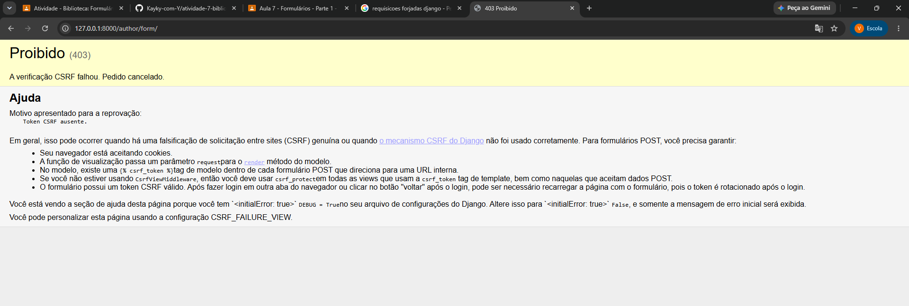

Nós escolhemos o on_delete.SET_NULL porque partiimos do pressuposto de que um livro pode ter mais de um autor, então se o autor x for excluído o y deveria permanecer. 

sem o csrf token ele não permite salvar no django, pq basicamente ele não confia no seu navegador já que você não tem um token que é necessário.