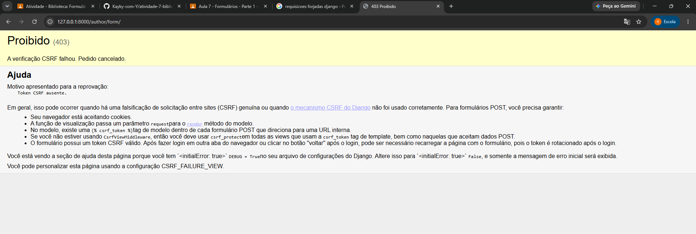

Nós escolhemos o on_delete.SET_NULL porque partiimos do pressuposto de que um livro pode ter mais de um autor, então se o autor x for excluído o y deveria permanecer. 

sem o csrf token ele não permite salvar no django, pq basicamente ele não confia no seu navegador já que você não tem um token que é necessário.

1.2 - a) O LivroModelForm não precisou de alterações lógicas manuais porque, ao herdar de forms.ModelForm, ele inspeciona automaticamente a classe Meta e o model associado. O Django replica as restrições definidas no banco de dados (como max_length, blank e null) e executa a lista de validators atrelada a cada campo. Como o Admin do Django gera formulários baseados nesses mesmos modelos, as regras de validação são aplicadas consistentemente em toda a aplicação sem necessidade de duplicação de código.

b) Um validator é uma função isolada e reutilizável que recebe apenas o valor do campo e levanta um erro se a regra for violada; ele é ideal para verificações simples e independentes. Já o método clean_<campo>() pertence à classe do formulário, tem acesso à instância completa (self) e permite tanto validar quanto transformar o dado (ex: aplicar .strip()). Um exemplo de regra exclusiva para clean_<campo>() seria garantir que o título seja salvo sempre em maiúsculas ou remover espaços em branco, pois isso exige a modificação do valor antes do salvamento, algo que um validator padrão não faz.

c) Para a regra em que o título não pode ser igual ao nome do autor, a estratégia correta é usar o método clean() geral do formulário, pois essa validação exige a comparação cruzada entre dois campos diferentes (titulo e autor_many), algo que só pode ser feito quando todos os dados já foram limpos individualmente. Já para garantir que o título seja salvo sem espaços no início e no fim, deve-se usar clean_titulo(), pois o objetivo não é apenas validar, mas transformar o dado antes do salvamento, retornando o valor já formatado com .strip(). Para limitar o número de páginas a no máximo 5000, a melhor estratégia é usar validators=[MaxValueValidator(5000)], pois é uma restrição numérica simples e nativa que se beneficia dos validadores embutidos do Django, mantendo o código mais limpo e declarativo. Por fim, para a regra de que um livro indisponível precisa ter o ISBN preenchido, deve-se usar novamente o método clean(), pois trata-se de uma validação condicional que depende do valor de outro campo (disponivel), exigindo acesso a múltiplos dados do formulário simultaneamente para verificar a consistência entre eles.

2.2 - a) Se esquecermos request.FILES na view, o formulário será instanciado apenas com os dados de texto (request.POST). O Django ignorará completamente o arquivo enviado, e o campo capa ficará vazio ou manterá o valor anterior, sem gerar nenhum erro explícito de validação. Se esquecermos o enctype="multipart/form-data" no template, o navegador enviará apenas o nome do arquivo como uma string simples, e não o conteúdo binário da imagem. Nesse caso, o request.FILES virá vazio e o formulário provavelmente acusará que o campo é obrigatório (se não for blank=True) ou simplesmente não salvará a imagem.

b) STATICFILES_DIRS e a tag  são usados para arquivos que fazem parte do projeto e não mudam, como CSS, JavaScript e imagens de layout (logo do site). Já MEDIA_ROOT e a propriedade .url são destinados a arquivos enviados dinamicamente pelos usuários, como a capa do livro. Na Mini Biblioteca, usamos  para o estilo visual do site e {{ livro.capa.url }} para exibir as capas que os usuários fizeram upload.

c) A extensão do arquivo pode ser facilmente falsificada (ex: renomear um script malicioso .exe para .jpg). Outros cuidados essenciais incluem: validar o "magic number" (assinatura real do arquivo) para garantir que é uma imagem válida, limitar o tamanho do arquivo para evitar ataques de negação de serviço (DoS) que lotam o disco, armazenar os uploads fora da raiz pública do servidor web e usar nomes de arquivo aleatórios para evitar sobrescrita e execução de scripts.